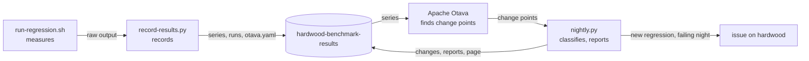

# Regression suite

Describes how the suite measures Hardwood versions against each other: how a benchmark builds
against any version, how a contender is measured and judged settled, how a run's results are
recorded into a history, and how the nightly job on the N300 finds and reports
regressions in that history.

Related documents:

- [Benchmark workload coverage](BENCHMARK_WORKLOAD_COVERAGE.md): the benchmarks, the
  contenders the regression presets time and the path each covers alone.
- [README](../README.md#comparing-versions): running the profiles and what a run writes;
  `nightly.sh --help` gives the nightly job's options, backfilling among them.
- [Benchmark reference](../BENCHMARKS.md): each benchmark's workload, contenders and gate.
- [Version adapters](../src/compat/README.md): the API concerns that differ between Hardwood
  versions and how to add one.
- [hardwood-benchmark-results](https://github.com/hardwood-hq/hardwood-benchmark-results#readme):
  the layout and columns of the recorded history.
- [The N300 runbook](https://github.com/gunnarmorling/cloud-boxes/blob/master/n300/benchmark.md#nightly-regression-run):
  the box, its clock pin and the timer that starts the nightly job.
- [The plan](../_plans/REGRESSION_SUITE.md): what is still to be built.

## Components

Four parts, each with one job; all of them run on the machine that measures.

| Part | Reads | Writes |
|---|---|---|
| `run-regression.sh` | a profile, one or more Hardwood versions | a run's raw output, outside the results: per script the timings and `RegressionProfiler`'s per-iteration metrics, `manifest.json` describing machine and JVM, `tables.md`, `not-run.txt` |
| `charts/record-results.py` | one version's raw output | in the results: one row per contender into that contender's series, a copy of the raw output under `runs/`, `epochs/`, `machines/`, and `otava.yaml` regenerated from the series |
| Apache Otava | `otava.yaml` and the series | nothing; it prints the change points it finds |
| `charts/nightly.py` | Otava's change points, the series, side-by-side runs | `changes.json`, `nights.csv`, `reports/`, `history.json` and `index.html`, an issue on Hardwood per new regression, and one while nights fail |

`nightly.sh` drives all four once a night and works through a queue of backfills after; a
backfill runs the first two and regenerates the page, and a batch of backfills is analysed once
it is done.

## Runs, series and epochs

A **run** is one invocation of `run-regression.sh` for one version: what it measured, on
one machine, at one time. A **series** is the history of one contender: one row for each run
that measured it, with the measured commit's time, the commit, the version, the run, the
verdict and the metrics. A run adds a row to every series it measured and nothing to the
others, so a run that skips a script or a contender leaves those series a row shorter and
affects no other.

A series is identified by its contender, its **epoch** and its **machine epoch**
(`series/<machine epoch>/<Benchmark>/<contender>@<epoch>.csv`), and no series mixes two of
either:

- A contender's epoch hashes what it measures: its script's preset, the iteration counts
  every preset shares, its benchmark method's source and the benchmarks' own code the method
  reaches, its parameters and the files it reads, each by name and size to three significant
  figures. The reached code (`charts/benchcode.py`) is every method the method calls by name,
  in its own class or another (`Scans.hardwoodFiltered(...)`); every field and constant it
  uses, with each assignment to it, `@Setup` methods' included; the types nested in a class it
  names; and the whole source of any other benchmarks class it names otherwise; each followed
  in turn and hashed without comments, whitespace or imports. A change to a helper therefore
  starts the epochs of the contenders that reach it, and setup or checking code reached through
  a field counts as reached, which errs towards a new epoch. Java is read with patterns rather
  than parsed, so a reference the patterns miss leaves an epoch as it would be without it.
  Left out are the version adapters under `src/compat`, which one a run compiles depending on
  the Hardwood version, so that they differ between the rows of one series by design, and the
  classes that make fixtures (`*Generator`, `*Downloader`) or write reports (`BenchReport`),
  since the fixture's name and size stand for the data. Each run's manifest records the
  benchmarks commit it ran, `+` marking local changes. A benchmark declares those files in its
  meta sidecar (`BenchReport.fixture`), once for all its contenders and again for each
  contender that reads other files, and recording fails for a contender with none declared.
  A contender whose input is generated in memory declares none. The size is
  rounded because the version that writes a generated fixture leaves its name in the file's
  metadata, which changes the size by a few hundred bytes without changing the data.
- A machine epoch hashes the machine and JVM a run's manifest describes: CPU, core count,
  microcode, the JDK build, the JVM's heap and collector flags, governor, clock and turbo.
  The kernel is recorded but not hashed: a distribution ships one every few weeks, and series
  that restarted with each would rarely hold enough rows to analyse. A step a kernel causes
  shows as a change point at a commit where Hardwood did not change, and the side-by-side run,
  which runs both commits on one kernel, does not reproduce it.

A new hash starts a new series and leaves the old one as it is. When the key itself changes,
recording first hashes every existing machine epoch again and moves its series to the new
key, merging rows where two old epochs map to one, so a change to the key keeps the rows.

A row's time is the measured commit's, not the run's, and a series is kept in that order:
Otava reads rows in file order, and a version backfilled after newer ones must land before
them. A row whose contender did not settle, or whose forks disagree, goes to the series'
`.unsettled.csv` twin, which Otava does not read.

## Building against any version

`--hardwood-version V` sets the `hardwood.version` pom property of the build, so a run
measures any released or locally installed `hardwood-core`. A script compiles the shared
classes in `dev.hardwood.benchmarks` and its own package (`BENCH_PACKAGE`) into
`target/build/<version>_<package>`, reused until a source, the pom or the resolved
`hardwood-core` jar is newer.

Every benchmark builds against every Hardwood version from 1.0.0.Final on. Where the API
differs between versions, a benchmark calls an adapter in `dev.hardwood.benchmarks.compat`,
of which `src/compat` holds one implementation per API form. Before compiling, the build tries
each form against the requested version with `javac` and takes the first that compiles, so
the choice follows the API the version has, also for a snapshot, whose version string says
nothing about it. An adapter on a timed path delegates directly, and the JIT inlines it.

A feature an older version lacks carries the first release that has it. A script that needs
it (its package's `REQUIRES`) does not build on an older version and says it is not
supported; a benchmark that can run without some of its contenders or parameter values
leaves those out and says so (`Features`), in its timed run and its gate alike. Where no form
compiles against a version that should have the feature, the build stops: a missing adapter
is a defect, never a skip.

## Measurement

**The preset.** `--regression` fixes a run's whole configuration, so that runs taken at any
time are alike: each script's reduced sizes and contender subset, its warmup, the measurement
iterations and forks every preset shares, a fixed heap and collector in every benchmark JVM,
`RegressionProfiler` in every fork, and one pass on all cores. A script's warmup is as long as
its contenders took to settle on a 1.50 GHz Intel N300, the slowest machine the suite runs on;
being time-based, it covers more operations on a faster one. Pinned to one core, the JIT, the
collector and the reader's workers would share the core and a contender would settle far
later, so a preset runs on all cores. Passing a flag the preset sets is an error. A preset
times Hardwood's contenders only: the suite compares Hardwood with itself.

**Forks.** Each contender runs in several forks, so a JIT decision that differs between JVMs
shows instead of being averaged away, and the noise band of a comparison comes from the
forks' means.

**What a fork records.** `RegressionProfiler`, a JMH profiler of the suite's own, appends one
line per iteration, warmup and measurement, to the run's `bench-metrics-<Benchmark>.jsonl`:
the score; the process's CPU time per operation, with the JIT compiler's and the collector's
apart; the bytes allocated per operation by every thread (`getTotalThreadAllocatedBytes`, so
threads that have ended count); and the heap-after-collection peak, the most heap in use
right after a collection during the iteration, which is empty when no collection ran; and the
caller time, the CPU time per operation of JMH's worker threads, which call the benchmark
method. Wall time
alone hides more work spread over more cores, and memory held longer than it should be; the
fixed heap makes the heap-after-collection peak measured alike from run to run. That peak is live
data plus objects promoted and not yet reclaimed, so it depends on how often collections run
and when the old generation was last cleared: where an iteration sees one or two collections,
runs of one commit can differ in it by as much as 40 %. A step in it that the GC time per
operation moves with is a change in what survives a young collection. Hardwood decodes on its
pool while the caller consumes, so a caller time close to the wall time means the caller never waits
on the pool: wall time then misses a decode change smaller than the caller's slack, and only
the process's CPU time shows it. The caller time counts all work on the caller's thread alike,
the benchmark's own loop and Hardwood's row path, and a busy wait as well. The series record it
(`caller_ms`, empty in rows from before it was recorded).

**Settled, bimodal** (`charts/settling.py`). A contender is "not settled" when its measurement
iterations are faster than the end of its warmup by more than a threshold and more than the
noise between successive iterations, in the median fork, and faster in most forks: its warmup
ended before steady state. It is "bimodal" when its forks' means split into groups further
apart than a share of their median and several times the spread within a fork: the JVMs took
different JIT decisions. Either verdict replaces faster or slower, and a row with either goes
to the unsettled twin of its series.

**Gates.** Before a script is timed, its gate checks that its contenders agree, against the
last version of the run, unless a gate already passed for the hash of the script's sources:
the script, what every script shares, and the packages of the benchmarks it runs. The hash
covers the files git tracks, at their working-tree contents, so a checkout with untracked
leftovers hashes as a clean clone of the same commit does. Passed
gates are kept under `~/.cache/hardwood-benchmarks/gates`. Fixtures are generated or
downloaded by those sources, so the hash covers them; a change in Hardwood alone runs no gate
again, since Hardwood's own tests cover its results. A script whose gate fails is not timed.

## The regression run

`run-regression.sh [--profile quick|nightly|smoke] V1 [V2 ...]` runs a profile's scripts
under `--regression`, one benchmark at a time over all its rounds, with the versions
interleaved within each round, so drift on the machine spreads over every version and each
benchmark's table is in before the next starts. `quick` times the contenders the coverage
document marks for it, `nightly` all of them, and `smoke` all of them once, without warmup, to
check what each version runs. It starts the emulated S3 endpoint once for the whole run when
`run-s3.sh` is among the scripts, and records the machine and JVM in `manifest.json`.

With one version a run ends in tables, which `charts/version-table.py` writes. With several it also writes `verdict.txt`, comparing
the first version with the last; `not-run.txt` gives the
reason for every benchmark a version could not run. A benchmark class belongs to one script,
since its meta sidecar holds the fixture a contender's series is keyed on; a run in which two
scripts write the same class's results fails. `run-nested-columns.sh` therefore times
`NestedColumnScanBenchmark`, which reads the Overture file as `run-nested.sh`'s column readers
do, under a preset of its own.

**The comparator.** `charts/compare-runs.py BASE NEW` prints per contender the base time, the
new time, the delta and a verdict, calling a delta only when it clears a noise band: from the
forks' means where both sides have forks, from the spread of repeated runs where both have
those, and a fixed threshold otherwise, and it says which. A differing machine, JVM, dataset
key or preset, or two snapshots of one Hardwood build, draws a warning before any number.
`--control REGEX` marks pinned contenders, whose moves are reported as drift, never as a
regression.

**Against the history.** `charts/against-history.py OUT VERSION --results DIR` compares one
run with the latest nightly results of the same machine: per contender, the latest settled
value of the series the run would be recorded into (same contender, epoch and machine epoch),
the commit it measured, the run's value and the delta, for wall time, CPU, allocation or the
heap-after-collection peak. It summarises the run as recording does (`record-results.py`'s
`summarise`), so the series it compares with is the one recording would extend. The latest
nightly value is a single row, so a delta is called worse or better only beyond a fixed band: a
hint, not a verdict. A call on the heap-after-collection peak means something only where the GC
time moves with it. A contender whose definition differs from the nightly one has no series to
compare with, and says so. Hardwood's `hardwood-quick-vs-nightly` skill runs the `quick` profile for
a branch on the N300 and shows this table.

**The version chart.** `charts/make-version-chart.py`, run by hand, charts each Hardwood
contender across any number of snapshots in the order given, labelled with the version, and
the commit for a snapshot build. A version that could not run a contender is drawn as missing.

## Change points

**Analysis.** Each night, after recording, `nightly.py` runs Otava over every settled series of
the machine epoch, on wall time, CPU and allocation; the caller time and the
heap-after-collection peak are recorded and charted, not analysed. Otava alone decides what
changed: it runs once per metric, with a minimum change of its own for each (`MAGNITUDES`),
since CPU time carries the JIT's and moves more night to night than wall time, and allocation
hardly moves at all. Otava fits each series' whole history each time, so it returns every
change point, old ones included, and one may shift by a row or two as rows arrive.
`changes.json` keeps every change point found, keyed by series and commit (see Matching below). Each has a status, set once:

| Status | Meaning |
|---|---|
| `regression` | worse, at a commit a night measured as its own (`nights.csv`); an issue is opened |
| `history` | worse, at a commit only a backfill measured; alerts no one |
| `improvement` | better |
| `unstable` | the contender's rows have not settled for the last `UNSTABLE_NIGHTS` nights in a row; an issue is opened |

Where wall time moved, its direction decides between regression and improvement: a CPU or
allocation increase that buys a faster operation is an improvement, listed with the metrics
that rose. Without a wall-time change, any metric that rose makes a regression. A regression
counts however many rows Otava needed to see it: a step that shows only after a
week of nights opens its issue then.

A contender whose rows stop settling leaves Otava's view, since only settled rows reach it, so
a regression in it would go unseen. That is a change point of its own: when the latest nights'
rows of a series have all not settled for `UNSTABLE_NIGHTS` nights, `changes.json` gets an
`unstable` entry keyed by the first of those nights, once per such run of nights; a superseded
epoch's series ends before the latest night and is left out. Its issue names the commits since
the last night it settled.

**Side by side.** The commit before and the commit after of each new regression run again,
interleaved over two rounds, in `run-regression.sh`'s several-version mode, limited to the
change point's script, while the night has time. What they measure, each flagged metric's
change between the two medians and every fork's value, goes into the change point and its
issue as evidence: a change that does not show side by side may come from the machine rather
than the code. It decides nothing.

**Alerts.** A new regression opens an issue on `hardwood-hq/hardwood`, labelled
`performance` and `bug`, naming the series, the commit range and each metric's change in the
history and side by side, with a link to the night's report. `changes.json` records the
issue, so it is opened once; one that could not be opened is opened by the next night. With
alerts off, each night marks what it found as found with alerts off, so turning them on opens no
backlog. A night that records nothing, whose analysis fails or whose issues cannot be opened
exits 1 or alerts, and keeps one issue, "Nightly regression job failing", open: the first such
night opens it, each further one comments, and the next good night closes it.

**Matching.** Otava fits each series' whole history each night, and backfilled rows land
between existing ones, so a change point it finds again may sit a few rows from where it was
first found. A change point is the one already in `changes.json` when it lies within the known
one's commit range, widened by `SHIFT_ROWS` on either side.

## The nightly job

`nightly.sh` runs from a systemd timer on the N300. It keeps its clones of Hardwood, the
benchmarks and the results under `~/nightly`, brings the benchmarks to `origin/main` first,
and runs a copy of itself, since bash reads a script while running it.

**The box to itself.** A night holds a lock (`~/nightly/lock`) and starts only when no JVM runs
and no one else pinned the clock; it pins the clock and restores it at the end. While it
measures, a watcher looks for JVMs outside the job's control group; one voids the night, which
records nothing. A JVM that has ended before the watcher reads it is skipped, since the job's
own forks and builds end all the time. A skipped or void night still writes a report saying
why.

**A night.** The job builds `origin/main` as a snapshot (`<version>-main<sha>-SNAPSHOT`),
runs the nightly profile, records the run, analyses, runs the new regressions side by side
while time remains, writes the night's report and the page, and pushes to the results
repository's `main`. Then it opens the issues of new regressions and closes a failing-night
issue, unless it runs with `--no-alert`. The report lists every change point found that
night, history and improvements included.

**The queue.** `~/nightly/queue` holds backfills, one per line: a release version or a
commit, and the scripts to run. After the night's own work the job takes items from it while
it is within its window; an item that starts runs to completion, and the rest wait for the
next night. When a contender's epoch or machine epoch starts, the night queues every release
the history page marks, from 1.0.0.Final, the oldest the benchmarks build against, and the
previous night's commit for the scripts concerned, so that every
series holds every release. `--backfill` works through the queue at once, without measuring a
night. Once a batch of backfills is in, the job runs the analysis over every machine epoch:
once, not after each backfill, since Otava fits whatever rows a series has, and a series half
way through a batch shows steps the rest of it fills in. It records no night and runs nothing
side by side; a regression it finds at a night's commit (backfilled rows can move Otava's fit)
is run side by side by the next night, which takes every regression not alerted yet that has no
side-by-side run, and its failure fails the run.
A backfill records a contender only where its series holds no settled row of the commit yet: a
script backfilled for one new contender runs its other contenders too, and they would otherwise
get a second row for a commit they already hold. A commit whose row did not settle can be
backfilled again. A night's own run of a commit already recorded adds
its row, since measuring the same commit night after night is how calibration reads the noise.

**The report and the page.** `reports/<date>.md` lists what the night measured, each
contender's metrics against the median of its series' last nights and its caller share (caller
time against wall time, marked from 0.8, where wall time misses decode changes), what did not
run, and the change points found that night. `index.html` with `history.json` charts every
series of a machine epoch: per contender its wall time, CPU, allocation, heap-after-collection
peak and caller share against commit time, unsettled rows hollow and off the line, an unstable contender marked, each run's
forks as a whisker on wall time, change points marked, releases marked at the commit of the
measured line each was cut from, whether or not they were measured (one whose fork point lies within a day of an earlier release's, such as a maintenance release, marks nothing of its own and is left out), and the newest epochs each in
its own colour, superseded ones faded. The charts open on the last 60 days of commits, where the nights are, and show every row on
request. Dragging across a chart narrows every chart to that time range,
each y axis fitted to the values in it. A sticky bar holds the machine and the zoom; a panel above
the charts shows the latest nightly run: what it measured and in how long, or why it recorded nothing,
the change points it found, and a bar per nightly run of its measuring and gate time, per script on hover (backfills, whose time depends
on the version and the scripts they ran, are left out); a point links to the
report of the night that measured it, or to the tables of any other run, both as GitHub renders them.

**Credentials.** Pushing uses a token for the results repository alone, and opening issues one
for issues on Hardwood alone, each in its own file under `~/nightly`, since a fine-grained
token grants its permissions on every repository it covers.
