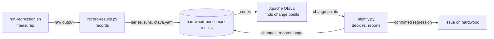

# Regression suite

Describes how the suite measures Hardwood versions against each other: how a benchmark builds
against any version, how a contender is measured and judged settled, how a run's results are
recorded into a history, and how the nightly job on the N300 finds, confirms and reports
regressions in that history.

Related documents:

- [Benchmark workload coverage](BENCHMARK_WORKLOAD_COVERAGE.md): the benchmarks, the
  contenders the regression presets time and the path each covers alone.
- [README](../README.md#comparing-versions): running the profiles, recording a run,
  backfilling, the nightly job's options.
- [Version adapters](../src/compat/README.md): the API concerns that differ between Hardwood
  versions and how to add one.
- [hardwood-benchmark-results](https://github.com/hardwood-hq/hardwood-benchmark-results#readme):
  the layout and columns of the recorded history.
- [The N300 runbook](https://github.com/gunnarmorling/cloud-boxes/blob/master/n300/benchmark.md#nightly-regression-run):
  the box, its clock pin and the timer that starts the nightly job.
- [The plan](../_plans/REGRESSION_SUITE.md): what is still to be built.

## Components

Four parts, each with one job; all of them run on the machine that measures.

| Part | Reads | Writes |
|---|---|---|
| `run-regression.sh` | a profile, one or more Hardwood versions | a run's raw output, outside the results: per script the timings and `RegressionProfiler`'s per-iteration metrics, `manifest.json` describing machine and JVM, `tables.md`, `not-run.txt` |
| `charts/record-results.py` | one version's raw output | in the results: one row per contender into that contender's series, a copy of the raw output under `runs/`, `epochs/`, `machines/`, and `otava.yaml` regenerated from the series |
| Apache Otava | `otava.yaml` and the series | nothing; it prints the change points it finds |
| `charts/nightly.py` | Otava's change points, the series, confirmation runs | `changes.json`, `nights.csv`, `reports/`, `history.json` and `index.html`, and an issue on Hardwood per confirmed regression |

`nightly.sh` drives all four once a night and works through a queue of backfills after; a
backfill runs the first two and regenerates the page, without analysing.

## Runs, series and epochs

A **run** is one invocation of `run-regression.sh` for one version: what it measured, on
one machine, at one time. A **series** is the history of one contender: one row for each run
that measured it, with the measured commit's time, the commit, the version, the run, the
verdict and the metrics. A run adds a row to every series it measured and nothing to the
others, so a run that skips a script or a contender leaves those series a row shorter and
affects no other.

A series is identified by its contender, its **epoch** and its **machine epoch**
(`series/<machine epoch>/<Benchmark>/<contender>@<epoch>.csv`), and no series mixes two of
either:

- A contender's epoch hashes what it measures: its script's preset, the iteration counts
  every preset shares, its benchmark method's source, its parameters and the files it reads,
  each by name and size to three significant figures. A benchmark declares those files in its
  meta sidecar (`BenchReport.fixture`), once for all its contenders and again for each
  contender that reads other files, and recording fails for a contender with none declared.
  A contender whose input is generated in memory declares none. The size is
  rounded because the version that writes a generated fixture leaves its name in the file's
  metadata, which changes the size by a few hundred bytes without changing the data.
- A machine epoch hashes the machine and JVM a run's manifest describes: CPU, core count,
  microcode, the JDK build, the JVM's heap and collector flags, governor, clock and turbo.
  The kernel is recorded but not hashed: a distribution ships one every few weeks, and series
  that restarted with each would rarely hold enough rows to analyse. A step a kernel causes
  shows as a change point at a commit where Hardwood did not change, and the confirmation,
  which runs both commits on one kernel, refutes it.

A new hash starts a new series and leaves the old one as it is. When the key itself changes,
recording first hashes every existing machine epoch again and moves its series to the new
key, merging rows where two old epochs map to one, so a change to the key keeps the rows.

A row's time is the measured commit's, not the run's, and a series is kept in that order:
Otava reads rows in file order, and a version backfilled after newer ones must land before
them. A row whose contender did not settle, or whose forks disagree, goes to the series'
`.unsettled.csv` twin, which Otava does not read.

## Building against any version

`--hardwood-version V` sets the `hardwood.version` pom property of the build, so a run
measures any released or locally installed `hardwood-core`. A script compiles the shared
classes in `dev.hardwood.benchmarks` and its own package (`BENCH_PACKAGE`) into
`target/build/<version>_<package>`, reused until a source, the pom or the resolved
`hardwood-core` jar is newer.

Every benchmark builds against every Hardwood version from 1.0.0.Final on. Where the API
differs between versions, a benchmark calls an adapter in `dev.hardwood.benchmarks.compat`,
of which `src/compat` holds one implementation per API form. Before compiling, the build tries
each form against the requested version with `javac` and takes the first that compiles, so
the choice follows the API the version has, also for a snapshot, whose version string says
nothing about it. An adapter on a timed path delegates directly, and the JIT inlines it.

A feature an older version lacks carries the first release that has it. A script that needs
it (its package's `REQUIRES`) does not build on an older version and says it is not
supported; a benchmark that can run without some of its contenders or parameter values
leaves those out and says so (`Features`), in its timed run and its gate alike. Where no form
compiles against a version that should have the feature, the build stops: a missing adapter
is a defect, never a skip.

## Measurement

**The preset.** `--regression` fixes a run's whole configuration, so that runs taken at any
time are alike: each script's reduced sizes and contender subset, its warmup, the measurement
iterations and forks every preset shares, a fixed heap and collector in every benchmark JVM,
`RegressionProfiler` in every fork, and one pass on all cores. A script's warmup is as long as
its contenders took to settle on a 1.50 GHz Intel N300, the slowest machine the suite runs on;
being time-based, it covers more operations on a faster one. Pinned to one core, the JIT, the
collector and the reader's workers would share the core and a contender would settle far
later, so a preset runs on all cores. Passing a flag the preset sets is an error. A preset
times Hardwood's contenders only: the suite compares Hardwood with itself.

**Forks.** Each contender runs in several forks, so a JIT decision that differs between JVMs
shows instead of being averaged away, and the noise band of a comparison comes from the
forks' means.

**What a fork records.** `RegressionProfiler`, a JMH profiler of the suite's own, appends one
line per iteration, warmup and measurement, to the run's `bench-metrics-<Benchmark>.jsonl`:
the score; the process's CPU time per operation, with the JIT compiler's and the collector's
apart; the bytes allocated per operation by every thread (`getTotalThreadAllocatedBytes`, so
threads that have ended count); and the live-set peak, the most heap in use right after a
collection during the iteration, which is empty when no collection ran. Wall time alone hides
more work spread over more cores, and memory held longer than it should be; the fixed heap
makes the live-set peak comparable from run to run.

**Settled, bimodal** (`charts/settling.py`). A contender is "not settled" when its measurement
iterations are faster than the end of its warmup by more than a threshold and more than the
noise between successive iterations, in the median fork, and faster in most forks: its warmup
ended before steady state. It is "bimodal" when its forks' means split into groups further
apart than a share of their median and several times the spread within a fork: the JVMs took
different JIT decisions. Either verdict replaces faster or slower, and a row with either goes
to the unsettled twin of its series.

**Gates.** Before a script is timed, its gate checks that its contenders agree, against the
last version of the run, unless a gate already passed for the hash of the script's sources:
the script, what every script shares, and the packages of the benchmarks it runs. The hash
covers the files git tracks, at their working-tree contents, so a checkout with untracked
leftovers hashes as a clean clone of the same commit does. Passed
gates are kept under `~/.cache/hardwood-benchmarks/gates`. Fixtures are generated or
downloaded by those sources, so the hash covers them; a change in Hardwood alone runs no gate
again, since Hardwood's own tests cover its results. A script whose gate fails is not timed.

## The regression run

`run-regression.sh [--profile quick|nightly|smoke] V1 [V2 ...]` runs a profile's scripts
under `--regression`, one benchmark at a time over all its rounds, with the versions
interleaved within each round, so drift on the machine spreads over every version and each
benchmark's table is in before the next starts. `quick` times the contenders the coverage
document marks for it, `nightly` all of them, and `smoke` all of them once, without warmup, to
check what each version runs. It starts the emulated S3 endpoint once for the whole run when
`run-s3.sh` is among the scripts, and records the machine and JVM in `manifest.json`.

With one version a run ends in tables, which `charts/version-table.py` writes. With several it also writes `verdict.txt`, comparing
the first version with the last; `not-run.txt` gives the
reason for every benchmark a version could not run. A benchmark class belongs to one script,
since its meta sidecar holds the fixture a contender's series is keyed on; a run in which two
scripts write the same class's results fails. `run-nested-columns.sh` therefore times
`NestedColumnScanBenchmark`, which reads the Overture file as `run-nested.sh`'s column readers
do, under a preset of its own.

**The comparator.** `charts/compare-runs.py BASE NEW` prints per contender the base time, the
new time, the delta and a verdict, calling a delta only when it clears a noise band: from the
forks' means where both sides have forks, from the spread of repeated runs where both have
those, and a fixed threshold otherwise, and it says which. A differing machine, JVM, dataset
key or preset, or two snapshots of one Hardwood build, draws a warning before any number.
`--control REGEX` marks pinned contenders, whose moves are reported as drift, never as a
regression.

**Against the history.** `charts/against-history.py OUT VERSION --results DIR` compares one
run with the latest nightly results of the same machine: per contender, the latest settled
value of the series the run would be recorded into (same contender, epoch and machine epoch),
the commit it measured, the run's value and the delta, for wall time, CPU, allocation or the
live-set peak. It summarises the run as recording does (`record-results.py`'s `summarise`), so
the series it compares with is the one recording would extend. The latest nightly value is a
single row, so a delta is called worse or better only beyond a fixed band: a hint, not a
verdict. A contender whose definition differs from the nightly one has no series to compare
with, and says so. Hardwood's `hardwood-quick-vs-nightly` skill runs the `quick` profile for
a branch on the N300 and shows this table.

**The version chart.** `charts/make-version-chart.py`, run by hand, charts each Hardwood
contender across any number of snapshots in the order given, labelled with the version, and
the commit for a snapshot build. A version that could not run a contender is drawn as missing.

## Change points

**Analysis.** Each night, after recording, `nightly.py` runs Otava over every settled series of
the machine epoch. Otava fits each series' whole history each time, so it returns every change
point, old ones included, and one may shift by a row or two as rows arrive. `changes.json`
keeps every change point found, keyed by series and commit, and a change point within a
couple of rows of one already there is the same one. Each has a status:

| Status | Meaning |
|---|---|
| `pending` | a regression waiting for its confirmation run |
| `confirmed` | the confirmation run reproduced it; an issue is opened |
| `refuted` | the confirmation run did not reproduce it |
| `improvement` | a change for the better; not confirmed |
| `history` | a regression whose commit after is not a recent night of the job's own |

**Recent nights.** `nights.csv` lists the commits the job measured as its own nights. Only a
regression whose commit after is among the last week's is confirmed. A change point that a
backfilled version reveals, or one in older rows, is history and alerts no one.

**Confirmation.** The commit before and the commit after run side by side, interleaved over
two rounds, in `run-regression.sh`'s several-version mode, limited to the change point's
script. A regression is confirmed when every fork of the commit after is worse than every
fork of the commit before, by at least half the change Otava found, on any metric Otava
flagged.

**Alerts.** A confirmed regression opens an issue on `hardwood-hq/hardwood`, labelled
`performance` and `bug`, naming the series, the commit range and each metric's change in the
history and side by side, with a link to the night's report. `changes.json` records the
issue, so it is opened once.

## The nightly job

`nightly.sh` runs from a systemd timer on the N300. It keeps its clones of Hardwood, the
benchmarks and the results under `~/nightly`, brings the benchmarks to `origin/main` first,
and runs a copy of itself, since bash reads a script while running it.

**The box to itself.** A night holds a lock (`~/nightly/lock`) and starts only when no JVM runs
and no one else pinned the clock; it pins the clock and restores it at the end. While it
measures, a watcher looks for JVMs outside the job's control group; one voids the night, which
records nothing. A JVM that has ended before the watcher reads it is skipped, since the job's
own forks and builds end all the time. A skipped or void night still writes a report saying
why.

**A night.** The job builds `origin/main` as a snapshot (`<version>-main<sha>-SNAPSHOT`),
runs the nightly profile, records the run, analyses, confirms pending regressions while time
remains, writes the night's report and the page, and pushes to the results repository's
`main`. Then it opens the issues of confirmed regressions, unless it runs with `--no-alert`.

**The queue.** `~/nightly/queue` holds backfills, one per line: a release version or a
commit, and the scripts to run. After the night's own work the job takes items from it while
it is within its window; an item that starts runs to completion, and the rest wait for the
next night. When a contender's epoch or machine epoch starts, the night queues the highest
release and the previous night's commit for the scripts concerned, so the new series has
comparison points. `--backfill` works through the queue at once, without measuring a night.
A backfill records a contender only where its series holds no settled row of the commit yet: a
script backfilled for one new contender runs its other contenders too, and they would otherwise
get a second row for a commit they already hold. A commit whose row did not settle can be
backfilled again. A night's own run of a commit already recorded adds
its row, since measuring the same commit night after night is how calibration reads the noise.

**The report and the page.** `reports/<date>.md` lists what the night measured, each
contender's metrics against the median of its series' last nights, what did not run, and the
change points found or decided. `index.html` with `history.json` charts every series of a
machine epoch: per contender its wall time, CPU, allocation and live-set peak against commit
time, unsettled rows hollow, each fork's mean faint, releases and change points marked, and a
break where a new epoch starts.

**Credentials.** Pushing uses a token for the results repository alone, and opening issues one
for issues on Hardwood alone, each in its own file under `~/nightly`, since a fine-grained
token grants its permissions on every repository it covers.
